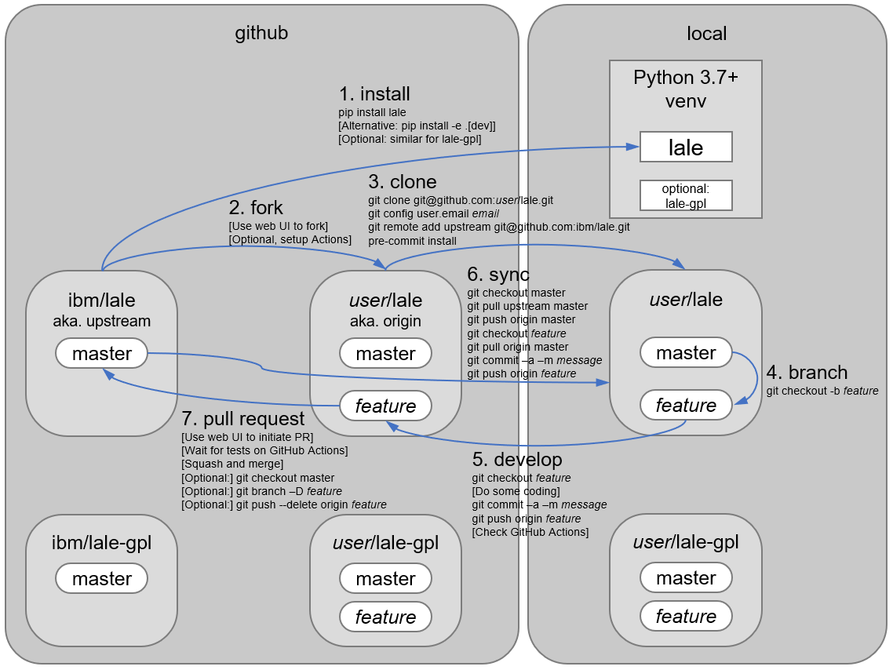

# Contributing to Lale

Lale is an open-source project, and we appreciate your help!

To make contributions to this GitHub repository, please submit a pull
request (PR).
Please ensure that your new functionality is adequately
covered by the regression test suite.
In addition, we expect contributors to submit a
"Developer's Certificate of Origin" by signing the following form:
[DCO1.1.txt](https://github.com/IBM/lale/blob/master/DCO1.1.txt).

One suggested contribution is adding more
[operators](https://github.com/IBM/lale/blob/master/examples/docs_new_operators.ipynb).
Furthermore, we recently gave a
[webinar](https://www.youtube.com/watch?v=szXkof_IiGc) as part of the
"Open Source Directions" series by Quansight. Among other things, the
webinar discusses possible contributions and future directions. So if
you are interested in contributing and are looking for inspiration, go
check it out!

The development workflow for Lale resembles that of other open-source
projects on Github. The following visualization shows how to submit a
PR:

Italics in the visualization indicate parts you have to substitute:
*user* (your user name), *email* (your email associated with github),
*feature* (the name of the feature branch you are working on), and
*message* (a description of your commit).

We have a pre-commit hook setup to help ensure that your code is
properly formatted and passes various static checks.
We highly recommend that you enable it, or at least run the check
before submitting a PR.  To do so, install the `pre-commit` python
package (this is done automatically if you `pip install -e .[dev]`).
Run `pre-commit install` in your `lale` repository to enable
pre-commit checking, or `pre-commit run --all-files` to just run the
checks once.

Some committers have experienced difficulties with the
[Pyright](https://github.com/Microsoft/pyright) pre-commit checks,
since they require `npm`. You can skip this check locally by running
`SKIP=pyright git commit ...`; of course, the check will still be
performed by the continuous integration tests in GitHub Actions.

# Making a Lale Release

Every successful build on master automatically creates a release on
[test PyPI](https://test.pypi.org/project/lale/), which can be
installed via `pip install -i https://test.pypi.org/simple/ lale`.

To make a release on [public PyPI](https://pypi.org/project/lale/),
which can be installed via `pip install lale`, perform the following
three steps:

1. Increment the version string.
    * The version string is stored in `lale/__init__` (as an example, [here is a prior version](https://github.com/IBM/lale/blob/b576449a3096847bab4962ab733d3c185a9afefc/lale/__init__.py#L17)).

    * As described above, submit a PR with the change.

    * Once the tests have passed, rebase the PR onto master.

2. Create a Github Release
    * Go to [the Releases page](https://github.com/IBM/lale/releases).

    * Click [`Draft a New Release`](https://github.com/IBM/lale/releases/new).

    * For the Tag version, use `vVERSION`. For example, if you put `"0.4.8"` as the version in the code, then the tag would be `v0.4.8`.

    * Add a title for the release.

    * Add a description of key changes in this release.

    * Click `Publish Release`.

3. Approve the deployment to PyPI
    * Publishing the release triggers the
      [`Deploy Release`](https://github.com/IBM/lale/actions/workflows/release.yml)
      workflow. It builds the package and publishes it to both test PyPI
      and public PyPI using
      [trusted publishing](https://docs.pypi.org/trusted-publishers/),
      so no API tokens or passwords are stored in GitHub secrets.

    * The deployment to public PyPI uses the `pypi` GitHub environment,
      which requires approval from a reviewer. The publish job will show
      as "Waiting" until it is approved (the test PyPI job does not
      require approval).

    * Open the workflow run under the
      [Actions tab](https://github.com/IBM/lale/actions/workflows/release.yml),
      click `Review pending deployments`, select `pypi`, and click
      `Approve and deploy`.

    * You are done!  Once approved, the release is deployed to public PyPI.

The trusted publisher configuration (on PyPI and test PyPI) and the
`pypi` / `testpypi` environments (in the GitHub repository settings)
must match the workflow file name and environment names used in
[`.github/workflows/release.yml`](.github/workflows/release.yml) and
[`.github/workflows/build.yml`](.github/workflows/build.yml). If they are
renamed, update the publisher settings accordingly.
